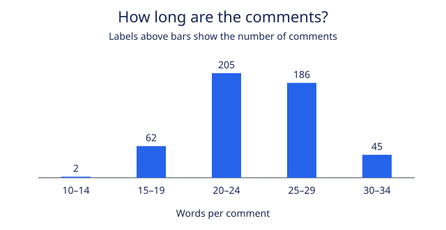

# JSONPlaceholder Comment Length Analysis

## Question and data

How long are comments in the JSONPlaceholder sample, and how does average
comment length vary across posts? I used the public
[JSONPlaceholder comments endpoint](https://jsonplaceholder.typicode.com/comments).

## Process

I retrieved the comments with Requests and preserved the original JSON.
The example used post records with `userId`, `id`, `title`, and `body`.
The comments include `postId`, `id`, `name`, `email`, and `body`. I checked
that each record had integer `id` and `postId` values and string `name`
and `body` values. In Polars, I selected the comment ID, parent post ID,
comment name, and body, then counted words using whitespace as the separator.
I exported the table as CSV and checked each row and word count against the
original JSON.

## Results

I verified 500 comments across 100 posts. Comment bodies
ranged from 14 to 34 words, with a mean of
24.0 words and a median of 24.0. The lowest
post-level average was 20.0 words (post 36), and
the highest was 28.8 words (post 77).

## Interpretation and next steps

Grouping comments by parent post lets me compare average lengths across
posts while keeping each individual comment available for review.
JSONPlaceholder provides demonstration data, so these patterns describe
the sample. A next step would be to try the workflow on a real discussion
dataset and compare length alongside other measures of participation.

## Reproduce the analysis

See the [project README](https://github.com/jrwebb7/nlp-04-api-text-data-custom#run-the-comments-project)
for the run command and output paths.
